
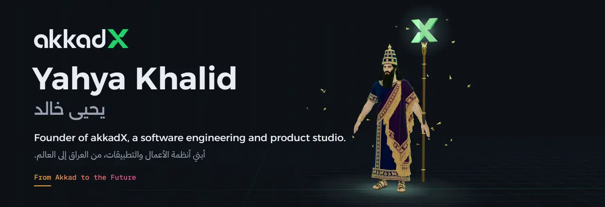


<a href="https://akkadx.github.io/anwar-ap/">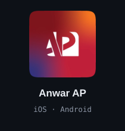</a><a href="https://akkadx.github.io/veva-clinic/">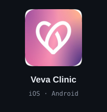</a><a href="https://akkadx.github.io/iqmdb/">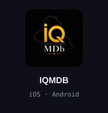</a><a href="https://akkadx.github.io/yarmouk-city/">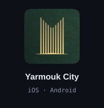</a><a href="https://akkadx.github.io/al-rafidain-mall/">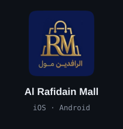</a><a href="https://akkadx.github.io/qittati/">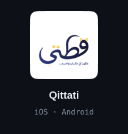</a><a href="https://akkadx.github.io/niche-corner/">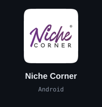</a><a href="https://akkadx.github.io/store-by-akkadx/">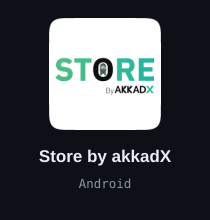</a><a href="https://akkadx.github.io/oud-corsets/">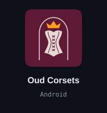</a><a href="https://watsy.me">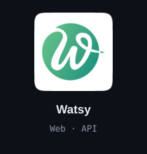</a><a href="https://crm.akkadx.com">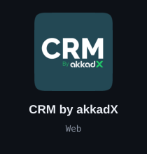</a><a href="https://iflashos.com">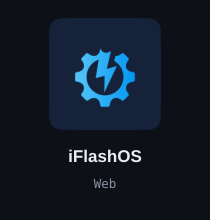</a>

  
  
  
  
  
  
  

