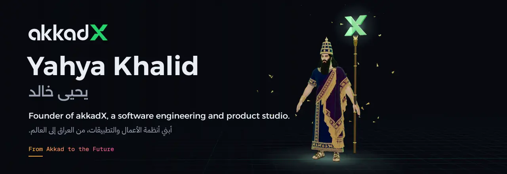
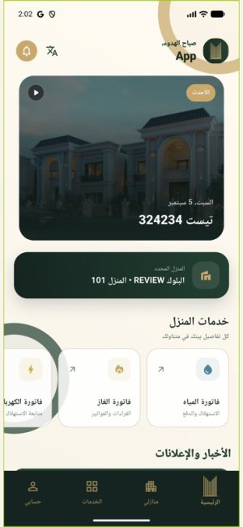
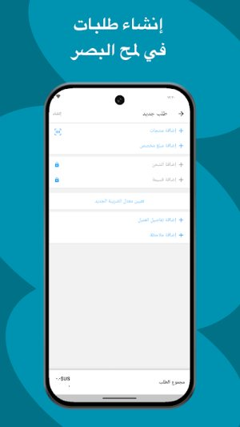
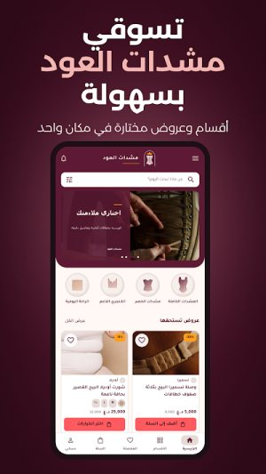
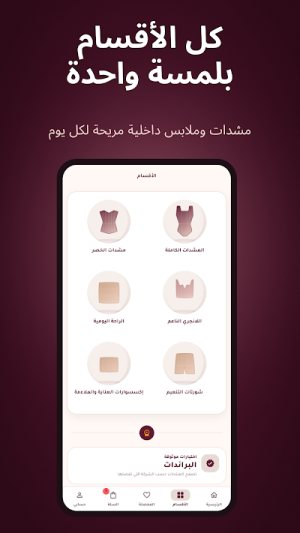
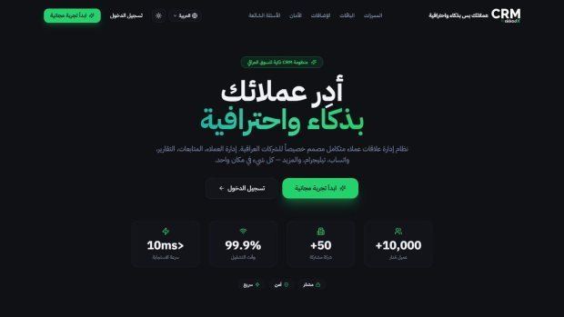
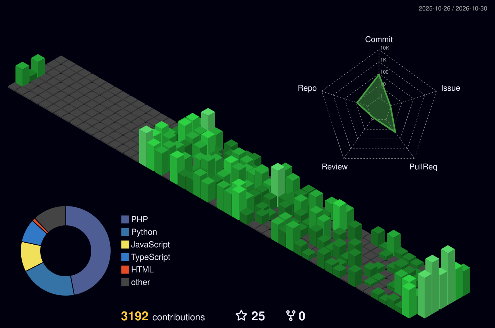

  

  
  
  
  

  

## Shipped apps · تطبيقات منشورة

Built and published under akkadX on the App Store and Google Play.

<table>
<tr>
<td align="center" width="50%" valign="top">
 
<b>IQMDB</b> 
A community app for films and series  
   
 
</td>
<td align="center" width="50%" valign="top">
 
<b>Yarmouk City</b> 
Resident app for a residential compound  
   
 
</td>
</tr>
<tr>
<td align="center" width="50%" valign="top">
 
<b>Al Rafidain Mall</b> 
Multi-category shopping with variants  
   
 
</td>
<td align="center" width="50%" valign="top">
 
<b>Qittati</b> 
Pet supplies, delivered  
   
 
</td>
</tr>
<tr>
<td align="center" width="50%" valign="top">
 
<b>Store by akkadX</b> 
Run a store from your phone  
   

</td>
<td align="center" width="50%" valign="top">
 
<b>Oud Corsets</b> 
A brand store app  
   

</td>
</tr>
<tr>
<td align="center" width="50%" valign="top">
<b>iFlashOS</b> 
Apple firmware, searchable  
  

</td>
<td align="center" width="50%" valign="top">
<b>CRM by akkadX</b> 
Multi-tenant CRM with WhatsApp and Telegram  
  

</td>
</tr>
</table>

## Open source

| Project | | |
|---|---|---|
| [**watsy-laravel**](https://github.com/yahyakhalid/watsy-laravel) | Laravel package for Watsy OTP |  |
| [**@akkadx/watsy**](https://www.npmjs.com/package/@akkadx/watsy) | Node.js SDK for Watsy |  |
| [**morabaa-woo-sync**](https://github.com/yahyakhalid/morabaa-woo-sync) | WooCommerce stock sync with Morabaa POS |  |

## Stack

## Activity

  

  

Most of my work lives in private client repositories. Live projects and case studies: <a href="https://akkadx.com/work">akkadx.com/work</a>

<b>Design. Engineer. Launch. Evolve.</b> نصمم. نهندس. نطلق. نطوّر.

